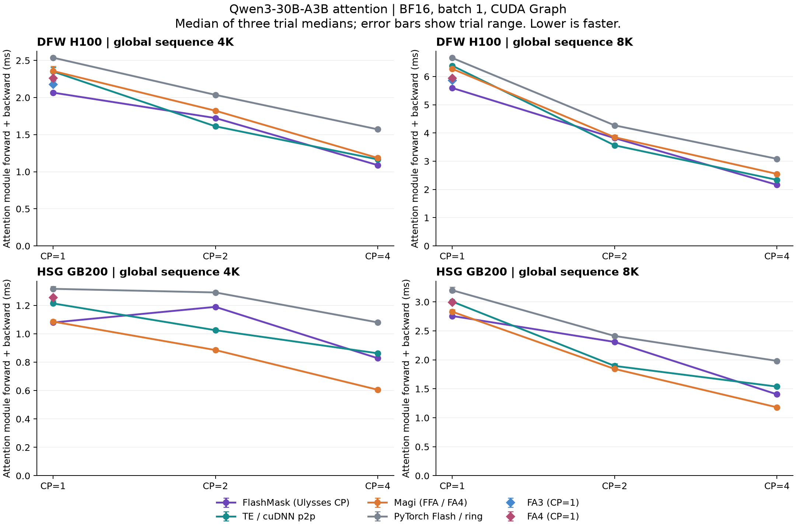

# FlashMask integration and Qwen3-30B-A3B module benchmark

Measured 2026-10-20 on DFW H100 SXM and HSG GB200. Branch:
`HuiyingLi/feat/flashmask-4397`; base AutoModel main `94a970aad`.
Integration commit `85d054322`; benchmark and contract refinements start at
`ba161cac5`. Every raw artifact records its source SHA and tracked diff hash.
Subsequent changes add teardown/validation guards, dependency instructions,
and the separate overlap comparator; the integrated timed kernel/CP algorithm
is unchanged. Full raw logs, JSON samples, installation scripts and hardware
manifests live on each cluster at
`/lustre/fsw/portfolios/coreai/users/huiyingl/flashmask4397/runs`.

The expanded [CP algorithms, flexible masks and packed-sequence report](CP_AND_MASKS.md)
adds TE all-gather/all-to-all/hybrid and native FlashMask CP alternatives.
The TE comparisons below refer specifically to the original TE p2p/ring baseline.

## Observed result

For CUDA Graph module forward+backward, FlashMask is fastest among these
comparators without CP on both hardware families. The GB200 4K difference
against Magi is only 0.6%, which should be treated as a near tie. On H100 it is about 14%
faster than TE and 5% faster than FA3. On GB200 it is 9–12% faster than TE,
while its margin over Magi is only about 1–3%.

With CP=2, TE is faster than FlashMask on both GPUs. With CP=4, FlashMask is
faster than TE on both GPUs. H100 FlashMask beats Magi at both CP degrees;
on GB200, Magi is fastest at CP=2/4 (FlashMask takes 19–37% longer at CP=4).
These are graph execution comparisons; the separate eager tables include
Python/launch overhead and should not be mixed with graph numbers. Eager
rankings differ: at GB200 8K/CP2, TE takes 2.950 ms, FlashMask 3.838 ms and
Magi 3.851 ms for module forward+backward.

## Scope and protocol

- Qwen3-30B-A3B attention: hidden 2048, 32 query heads, 4 KV heads, head dim 128,
  BF16, batch 1, one global 4096/8192-token causal sequence, no packing.
  Config revision: `ad44e777bcd18fa416d9da3bd8f70d33ebb85d39`.
- Module means the native `Qwen3MoeAttention`: Q/K/V and output projections,
  Q/K RMSNorm, RoPE, attention and CP communication. Common settings are Torch
  linear/RMSNorm and unfused RoPE. Core measures attention and CP transport only.
  Synthetic seeded weights are used; no checkpoint or full 30B MoE model is loaded.
- CP=1/2/4 uses one node. DFW uses H100 GPUs 4–7 on `pool0-01774` in allocation
  `20550163` (other work uses GPUs 0–3). HSG uses all four GB200 on
  `nvl72176-T02` in interactive allocation `8094720`, one NVLink fabric clique.
- FlashMask CP is differentiable Ulysses all-to-all; TE uses p2p CP with cuDNN
  fused attention (`NVTE_FLASH_ATTN=0`, `NVTE_FUSED_ATTN=1`). Magi uses its native
  dispatch/communication, FFA on H100 and its pinned FA4 backend on GB200.
  Standalone FA3/FA4 have no native AutoModel CP path; `sdpa` at CP>1 is the
  public PyTorch FlashAttention ring comparator.
- Identical seeded full inputs, weights, positions and upstream gradients are
  partitioned through each backend's token ordering. Per-rank output and input
  gradients, plus CP-summed module parameter gradients, are checked against
  the same full-sequence SDPA reference before timing. Reference execution,
  input dispatch, compilation and parameter-gradient synchronization are excluded.
- Warmup 10; three trials of 30 samples; max latency across CP ranks per sample.
  Table cells are **forward / forward+backward, milliseconds**, using the median
  of the three trial medians. CUDA Graph captures five steps per replay and
  validates replay output/input gradients. Eager event and wall timings are
  separate; Python/launch overhead is included in eager results.
- No overlapping benchmark processes were used for the final reported data.
  Two HSG CP4 entries were rerun after an early overlap probe initialized CUDA
  concurrently. Failed dependency probes and the initial graph teardown hang
  are preserved separately and replaced by successful runs.

## Dependencies and correctness

Both containers use torch `2.14.0a0+4fdf77b940.nv26.08`, CUDA 13.4,
NCCL 2.30.7, TE 2.19.0 and Transformers 5.15.1. FlashMask is pinned to
`5b1d0dcafd2d12e1b7df665223530fcbe140c270`, using CuTe DSL 4.5.2.
Standalone FA4 is 4.0.0b29 / CuTe 4.6.2. Magi is
`d7ea8afd44c790b65fab68a04a6a0fdd5adbf182`; its GB200 FA4 submodule is
`ee1d15159cda6f3f97bfab9e487da146a8254970` / CuTe 4.4.2, with the matching
`magi_to_hstu` and `create_block_mask` CUDA extensions. See [setup](../README.md).

The final focused CPU suite passes 10 tests, including real two-process Gloo
forward/backward transport and a negative token-order control. Both new
packed-metadata rejection tests fail against `85d054322` before the additional
guards, then pass with the guards (logs: `runs/guard_baseline.log` and
`runs/final_unit.log`). The earlier
broader attention/Qwen suite passed 90 tests with 51 existing skips; skips are
not correctness evidence. Actual FlashMask CUDA kernels passed three independent
FP32 mathematical-oracle tests on each GPU family (causal, document boundary,
fully masked rows). Import lint and Ruff passed.

All listed benchmark rows passed output/input/parameter-gradient checks.
These results validate attention components and CP transport. Native distributed
checkpoint loading, full model depth, MoE experts, packing, TP and end-to-end
training are not covered.

## Complete attention module: graph

### DFW H100

| CP | Global seq | flashmask | te | fa3 | fa4 | magi | sdpa |
|---|---|---|---|---|---|---|---|
| 1 | 4K | 0.595 / 2.066 | 0.700 / 2.350 | 0.640 / 2.177 | 0.665 / 2.261 | 0.727 / 2.357 | 0.781 / 2.537 |
| 1 | 8K | 1.582 / 5.594 | 1.829 / 6.383 | 1.683 / 5.867 | 1.767 / 5.942 | 1.846 / 6.272 | 2.004 / 6.658 |
| 2 | 4K | 0.591 / 1.724 | 0.416 / 1.612 | — | — | 0.470 / 1.822 | 0.635 / 2.036 |
| 2 | 8K | 1.238 / 3.817 | 1.021 / 3.563 | — | — | 1.080 / 3.849 | 1.391 / 4.270 |
| 4 | 4K | 0.372 / 1.089 | 0.364 / 1.166 | — | — | 0.294 / 1.186 | 0.538 / 1.571 |
| 4 | 8K | 0.709 / 2.163 | 0.651 / 2.339 | — | — | 0.601 / 2.550 | 1.072 / 3.085 |

### HSG GB200

| CP | Global seq | flashmask | te | fa4 | magi | sdpa |
|---|---|---|---|---|---|---|
| 1 | 4K | 0.332 / 1.080 | 0.408 / 1.214 | 0.402 / 1.256 | 0.327 / 1.086 | 0.480 / 1.317 |
| 1 | 8K | 0.841 / 2.757 | 0.916 / 3.005 | 0.911 / 2.993 | 0.782 / 2.830 | 1.086 / 3.201 |
| 2 | 4K | 0.444 / 1.190 | 0.309 / 1.025 | — | 0.260 / 0.885 | 0.436 / 1.291 |
| 2 | 8K | 0.842 / 2.309 | 0.656 / 1.895 | — | 0.566 / 1.843 | 0.874 / 2.412 |
| 4 | 4K | 0.309 / 0.828 | 0.313 / 0.863 | — | 0.174 / 0.606 | 0.436 / 1.080 |
| 4 | 8K | 0.507 / 1.404 | 0.532 / 1.538 | — | 0.358 / 1.181 | 0.717 / 1.982 |

## Complete attention module: eager

### DFW H100

| CP | Global seq | flashmask | te | fa3 | fa4 | magi | sdpa |
|---|---|---|---|---|---|---|---|
| 1 | 4K | 0.776 / 2.011 | 0.718 / 2.350 | 0.630 / 2.147 | 0.657 / 2.216 | 0.739 / 2.428 | 0.796 / 2.539 |
| 1 | 8K | 1.585 / 5.492 | 1.823 / 6.295 | 1.660 / 5.780 | 1.734 / 5.883 | 1.841 / 6.244 | 1.974 / 6.602 |
| 2 | 4K | 1.435 / 3.321 | 1.365 / 3.000 | — | — | 1.244 / 3.499 | 1.584 / 3.192 |
| 2 | 8K | 1.448 / 3.816 | 1.434 / 3.517 | — | — | 1.276 / 3.862 | 1.574 / 4.255 |
| 4 | 4K | 1.469 / 3.451 | 1.947 / 3.590 | — | — | 1.280 / 3.007 | 1.942 / 4.363 |
| 4 | 8K | 1.461 / 3.461 | 1.983 / 3.890 | — | — | 1.269 / 2.991 | 1.934 / 4.359 |

### HSG GB200

| CP | Global seq | flashmask | te | fa4 | magi | sdpa |
|---|---|---|---|---|---|---|
| 1 | 4K | 0.959 / 2.224 | 0.756 / 1.400 | 0.539 / 1.282 | 0.885 / 1.911 | 0.578 / 1.368 |
| 1 | 8K | 0.902 / 2.691 | 0.936 / 2.980 | 0.934 / 2.952 | 0.858 / 2.724 | 1.118 / 3.294 |
| 2 | 4K | 1.712 / 3.786 | 1.487 / 2.836 | — | 1.838 / 3.924 | 1.776 / 3.455 |
| 2 | 8K | 1.740 / 3.838 | 1.503 / 2.950 | — | 1.779 / 3.851 | 1.710 / 3.511 |
| 4 | 4K | 1.770 / 3.967 | 2.307 / 4.342 | — | 1.465 / 3.608 | 2.383 / 4.791 |
| 4 | 8K | 1.734 / 4.002 | 2.338 / 4.379 | — | 1.511 / 3.621 | 2.216 / 4.735 |

## Attention core: graph

### DFW H100

| CP | Global seq | flashmask | te | fa3 | fa4 | magi | sdpa |
|---|---|---|---|---|---|---|---|
| 1 | 4K | 0.222 / 0.994 | 0.276 / 1.126 | 0.218 / 0.932 | 0.229 / 0.997 | 0.300 / 1.128 | 0.361 / 1.272 |
| 1 | 8K | 0.883 / 3.493 | 1.001 / 3.985 | 0.847 / 3.411 | 0.931 / 3.537 | 1.018 / 3.855 | 1.161 / 4.210 |
| 2 | 4K | 0.402 / 1.171 | 0.189 / 0.767 | — | — | 0.247 / 0.979 | 0.414 / 1.189 |
| 2 | 8K | 0.870 / 2.750 | 0.590 / 2.312 | — | — | 0.645 / 2.644 | 0.965 / 2.983 |
| 4 | 4K | 0.265 / 0.766 | 0.239 / 0.731 | — | — | 0.169 / 0.754 | 0.410 / 1.138 |
| 4 | 8K | 0.516 / 1.612 | 0.425 / 1.498 | — | — | 0.379 / 1.702 | 0.846 / 2.235 |

### HSG GB200

| CP | Global seq | flashmask | te | fa4 | magi | sdpa |
|---|---|---|---|---|---|---|
| 1 | 4K | 0.114 / 0.501 | 0.100 / 0.469 | 0.095 / 0.482 | 0.106 / 0.510 | 0.188 / 0.570 |
| 1 | 8K | 0.416 / 1.660 | 0.398 / 1.661 | 0.388 / 1.660 | 0.417 / 1.742 | 0.524 / 1.831 |
| 2 | 4K | 0.314 / 0.809 | 0.137 / 0.406 | — | 0.127 / 0.511 | 0.271 / 0.693 |
| 2 | 8K | 0.608 / 1.664 | 0.343 / 1.131 | — | 0.339 / 1.213 | 0.574 / 1.591 |
| 4 | 4K | 0.232 / 0.596 | 0.204 / 0.519 | — | 0.093 / 0.368 | 0.342 / 0.758 |
| 4 | 8K | 0.378 / 1.028 | 0.364 / 0.932 | — | 0.227 / 0.805 | 0.552 / 1.373 |

## Attention core: eager

### DFW H100

| CP | Global seq | flashmask | te | fa3 | fa4 | magi | sdpa |
|---|---|---|---|---|---|---|---|
| 1 | 4K | 0.219 / 0.962 | 0.259 / 1.074 | 0.201 / 0.924 | 0.228 / 0.942 | 0.306 / 1.120 | 0.364 / 1.238 |
| 1 | 8K | 0.843 / 3.447 | 0.949 / 3.888 | 0.798 / 3.339 | 0.890 / 3.492 | 0.940 / 3.798 | 1.104 / 4.179 |
| 2 | 4K | 0.776 / 1.996 | 0.950 / 2.178 | — | — | 0.744 / 1.944 | 1.089 / 2.278 |
| 2 | 8K | 0.878 / 2.748 | 0.998 / 2.274 | — | — | 0.749 / 2.611 | 1.092 / 2.990 |
| 4 | 4K | 0.792 / 2.045 | 1.528 / 2.687 | — | — | 0.761 / 1.984 | 1.482 / 3.355 |
| 4 | 8K | 0.774 / 2.081 | 1.591 / 2.911 | — | — | 0.770 / 2.046 | 1.418 / 3.358 |

### HSG GB200

| CP | Global seq | flashmask | te | fa4 | magi | sdpa |
|---|---|---|---|---|---|---|
| 1 | 4K | 0.254 / 0.838 | 0.291 / 0.536 | 0.100 / 0.476 | 0.245 / 0.667 | 0.196 / 0.561 |
| 1 | 8K | 0.385 / 1.578 | 0.351 / 1.496 | 0.338 / 1.554 | 0.364 / 1.608 | 0.520 / 1.746 |
| 2 | 4K | 1.120 / 2.485 | 0.984 / 1.878 | — | 0.806 / 2.876 | 1.209 / 2.471 |
| 2 | 8K | 1.086 / 2.542 | 1.050 / 1.953 | — | 0.953 / 2.239 | 1.229 / 2.483 |
| 4 | 4K | 1.112 / 2.548 | 1.760 / 3.293 | — | 0.831 / 2.154 | 1.992 / 3.912 |
| 4 | 8K | 1.107 / 2.573 | 1.834 / 3.354 | — | 0.856 / 2.209 | 1.675 / 3.739 |

## Supplemental upstream NCCL-GIN overlap

This is a separate benchmark-only adapter, not the integrated Ulysses path.
The pinned upstream Torch test wrapper required the included import-only
compatibility patch; no attention or communication algorithm was changed.

Upstream requires local sequence length >=4096 from a fixed supported set.
Global 4K/CP2, 4K/CP4 and 8K/CP4 are unsupported; they are not correctness
passes. Global 8K/CP2 passes output, input-gradient and parameter-gradient
checks, with worst relative RMS error 0.004618. Its CUDA Graph capture fails with
an invalid stream capture status in upstream orchestration. The fresh-process
eager run completes successfully. **Only eager results are compared below.**

| GB200, global 8K, CP=2 | Forward ms | Forward+backward ms |
|---|---:|---:|
| FlashMask upstream overlap | 1.676 | 3.984 |
| FlashMask Ulysses | 1.740 | 3.838 |
| TE | 1.503 | 2.950 |
| Magi | 1.779 | 3.851 |

[Overlap summary and source provenance](overlap_summary.json). Raw failed graph and unsupported-length logs are retained under `runs/overlap` on HSG.

## Data and checks

[CSV timings](timings.csv) includes trial ranges, eager wall time, parity maxima and input hashes.
[Artifact manifest](manifest.json) records raw JSON checksums and per-process metadata.

Across 432 timing rows, worst relative RMS error was 0.006089; worst normalized maximum error was 0.014085. Input hashes match across backends and CP degrees within each hardware/scope/length.
